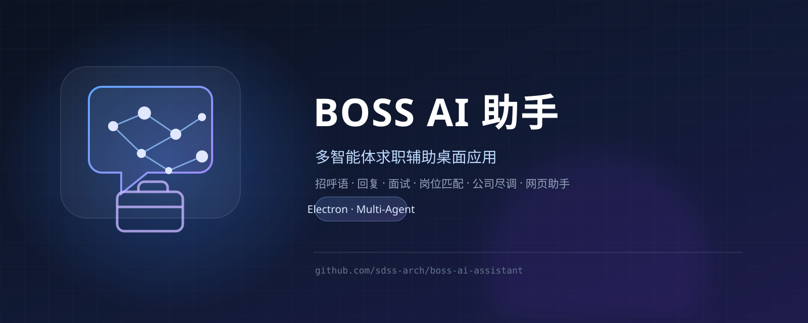
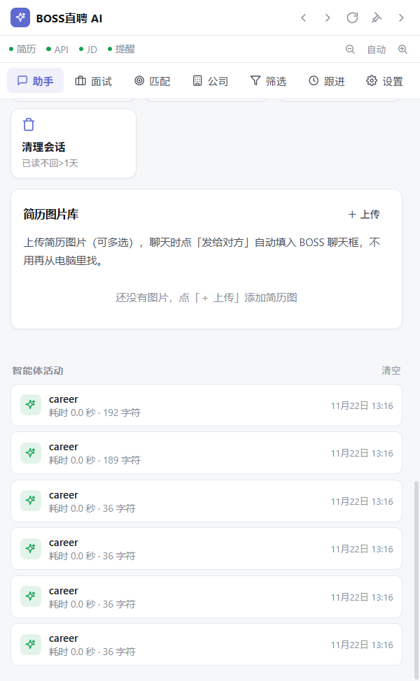
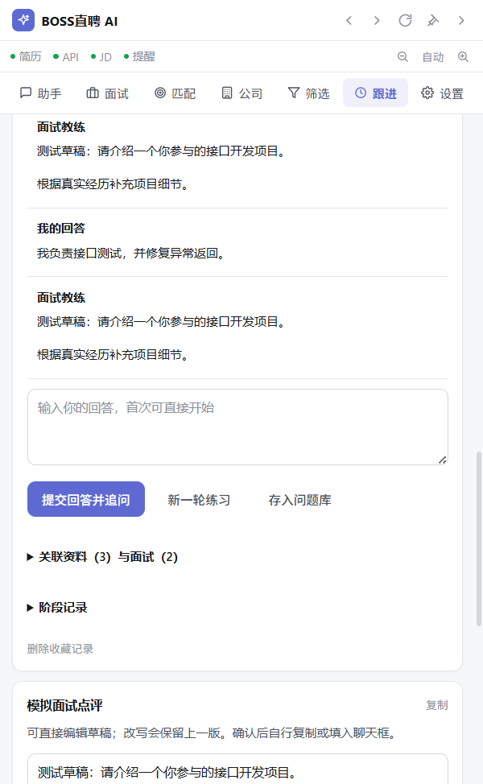
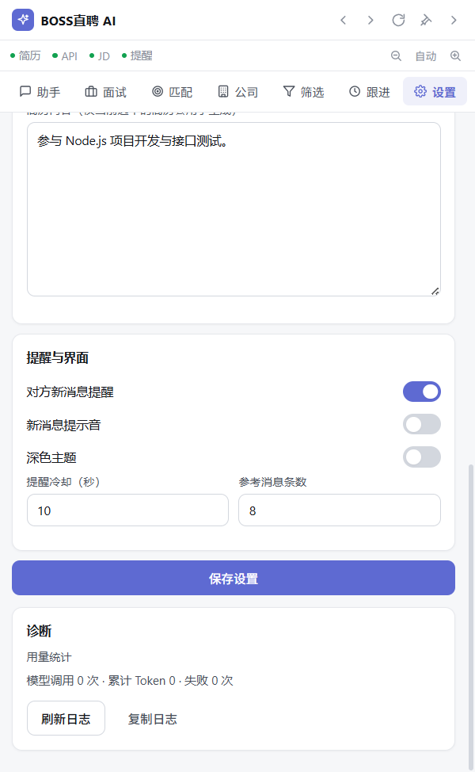
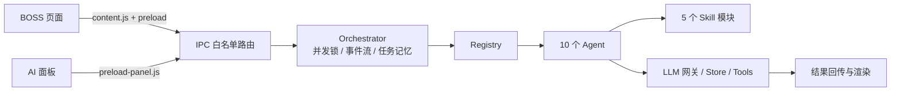

<p align="center">
  
</p>

<h1 align="center">BOSS直聘 AI 助手 · 桌面端</h1>

<p align="center">
  <a href="https://github.com/sdss-arch/boss-ai-assistant/actions/workflows/ci.yml"></a>
  <a href="https://github.com/sdss-arch/boss-ai-assistant/releases"></a>
  
  <a href="https://github.com/sdss-arch/boss-ai-assistant/releases"></a>
  
  
  <a href="./LICENSE"></a>
  <a href="https://github.com/sdss-arch/boss-ai-assistant/stargazers"></a>
</p>

<p align="center">
  基于 Electron 的多智能体求职辅助系统 —— 从打招呼到入职的全流程 AI 陪跑
</p>

---

> 📦 **迁移说明**：本项目迁移自 [`96806105/boss-ai-desktop`](https://github.com/96806105/boss-ai-desktop)，并在此基础上了完善网页助手、自动辅助、工作台、职业顾问 Agent、完整测试体系与工程治理（CI/CD、安全策略、文档体系）。旧仓库仅作历史存档，后续维护请以本仓库为准。详见 [更新日志](./CHANGELOG.md)。

> ⚠️ **免责声明**：受 BOSS直聘、小红书等平台页面结构改版与反爬风控机制影响，部分功能（页面元素采集、登录态保持、搜索结果提取等）可能存在 Bug 或偶发失效，本项目将持续跟进修复。本项目仅供学习交流与个人求职使用，请合理控制使用频率，遵守各平台用户协议与相关法律法规；因使用本工具产生的一切后果由使用者自行承担。

---

## 目录

- [项目简介](#项目简介)
- [核心特性](#核心特性)
- [界面预览](#界面预览)
- [系统架构](#系统架构)
- [技术栈](#技术栈)
- [快速开始](#快速开始)
- [使用指南](#使用指南)
- [目录结构](#目录结构)
- [数据与隐私](#数据与隐私)
- [文档](#文档)
- [常见问题](#常见问题)
- [贡献与维护](#贡献与维护)
- [License](#license)

---

## 项目简介

BOSS直聘 AI 助手是一个面向求职场景的桌面应用：在系统内嵌 BOSS直聘浏览器环境，右侧常驻 AI 面板，由 **10 个专业智能体（Agent）** 组成协作网络，覆盖求职全流程：

**沟通** → 招呼语、消息回复、求职信撰写、通用聊天  
**准备** → 面试模拟、岗位匹配、公司尽调、公司名解析、职业规划  
**决策** → 职位库智能检索、小红书口碑采集、风险速查  
**管理** → 网页直读、收藏跟进、面试记录、Offer 对比

所有生成内容基于用户真实简历与公开检索信息，杜绝编造；发送动作始终由用户手动确认，最大限度规避账号风控。

---

## 核心特性

### 🤖 多智能体编排（Supervisor 模式）

| 智能体 | 职责 | 核心技术 |
|---|---|---|
| 招呼语专家 | 基于 JD 与简历生成真人感打招呼语 | 按JD自然写作 + 独立事实与表达复核 + 原文依据 |
| 回复助手 | 贴合聊天语境自然应答 | 对话上下文采集 + 人话示例 + AI 痕迹禁用清单 |
| 面试教练 | 生成结构化面试准备卡 | 联网检索公司情报（多引擎）+ 简历深挖 |
| 岗位匹配师 | 职位库深度匹配打分 | 简历关键词驱动全库检索 + 三问思考式打分 + 补充要求覆盖 |
| 尽调分析师 | 输出企业尽调报告 | 百度/搜狗/Bing 三引擎并行采集 + 结构化字段抽取 |
| 求职信助手 | 撰写正式自荐信 | 真实经历论证链 + 防编造约束 |
| 聊天助手 | 通用问题解答与对话 | 上下文理解 + 简历匹配 + 多轮对话记忆 |
| 公司名解析器 | 从文本提取标准化公司名称 | 智能实体识别 + 标准化处理 |
| 避雷速查师 | 快速核查公司风险与口碑 | 司法风险扫描 + 招聘口碑分析 + 风险等级评估 |
| 职业顾问 | 结合当前网页岗位给出规划建议 | 岗位上下文读取 + 简历能力映射 |

### 🌐 网页助手（无需建档）

- 自动读取当前 BOSS 页面中的岗位详情或聊天上下文。
- 网页 AI 悬浮按钮可按住拖动，点击旁边的 × 关闭，位置和关闭状态自动保存；「设置 → 提醒与界面」可重新显示或恢复默认位置。
- 直接对当前网页执行简历诊断、优化、模拟面试和沟通草稿生成。
- 一键收藏当前职位或匹配结果，按「感兴趣 / 已沟通 / 已投简历 / 面试中 / Offer / 已结束」跟进。
- 收藏记录保存 JD、简历快照、沟通摘要、生成文案、面试准备卡和公司报告，页面下架后仍可查看。

### ⚡ 自动辅助

- 配置一次模型与简历后默认开启（本地模型无需 API Key）；自动生成岗位分析、沟通摘要、回复草稿和面试要点。
- 页面或消息变化时自动更新；相同内容复用缓存，短时变化合并处理。
- 新消息草稿自动填入空闲聊天框；正在输入或已有人工草稿时保留原内容。
- **不会**自动点击发送、提交简历或确认面试；明确日期与原文依据的面试安排才建立待确认记录。

### 🎯 岗位匹配（全库检索 + 定时监控）

- **全库检索**：从简历提取技能关键词，后台隐藏窗口逐词检索 BOSS 职位库（约 120+ 候选）。
- **思考式打分**：核心要求是什么 / 简历能否实质支撑 / 差距能否补上；没有具体经历支撑的一律不超过 60 分。
- **补充要求覆盖**：临时指定城市、薪资底线、排除关键词、外包及双休条件（内置 100+ 城市代码）。
- **定时刷新**：15/30/60 分钟自动重检，新出现的高分岗位面板横幅提醒；一键跳转岗位详情。

### 📝 招呼语与真实经历

- 根据当前 JD 与所选简历自然撰写直击痛点 / 极简高冷 / 业务共情三版，保留三种内置写作偏好与自定义表达。
- 每版最多400字，不设最低字数；极简版最短，但保留有用的产品背景和实际工作，不追求字数越少越好。
- 允许归纳、改写和组织多条相关事实，不再用固定开场收尾拼接一条简历原句。每版记录实际引用的简历编号。
- 程序校验长度、完整性、未知证书状态、编造备考、参与程度升级、量化事实和链接来源；关键门槛资料未确认时不写成自身缺点。
- 写作后另发起一次独立复核，逐项核对个人事实、经历与岗位的实际关系、语句是否自然及三版策略差异；不合格最多重写并复核一次，仍不通过则报错，不展示未经复核的草稿。
- 独立复核仍依赖所选模型的判断，不保证完全消除模型错误；卡片可展开「查看简历依据」自行核对，回填只包含正文。
- 历史生成文案不作为事实输入；作品链接不强塞，无关经历不用于补齐三版，不能用一般工作经验冒充资格替代品。

### 🏢 公司尽调与工作台

- 三引擎并行采集工商 / 司法 / 舆情 / 股权线索，多值投票抽取结构化字段，自动识别关联公司污染。
- 小红书站内口碑需用户自行登录并复制粘贴为证据，报告优先引用并标注「个人观点不代表官方事实」。
- 工作台：今日待办、面试记录、Offer 保证年现金对比、渠道与简历版本统计、JSON / ICS 导出。
- 深色 / 浅色主题、窗口置顶、面板折叠、BOSS 视图缩放。

---

## 界面预览

> 以下截图由 `npm run capture:screenshots` 在临时用户目录中使用 **mock 数据**生成，不包含任何真实简历或聊天记录。

| 网页助手（自动读取当前岗位） | 工作台（收藏 / 面试 / Offer） |
|---|---|
|  |  |

| 设置（写作风格 / 简历 / 密钥） | 品牌标识 |
|---|---|
|  |  |

---

## 系统架构



**关键设计**

- **数据流**：BOSS 页面 DOM 采集 → IPC → Orchestrator 路由 → Agent（工具检索 + LLM）→ 结果回渲染。
- **Agent 基类**：统一生命周期 `resolveTools → buildMessages → llm.call`，每个 Agent 独立角色 / 温度 / 模型 / 工具。
- **Skills 系统**：模块化技能封装，支持动态加载与热插拔。
- **LLM 网关**：超时 / 5xx 重试 / 用量统计 / 按模型裁剪参数。
- **并发保护**：同一时刻仅允许一个 Agent 任务运行，定时任务自动跳过忙时。
- **安全边界**：网页桥接只暴露白名单接口，敏感配置不进入渲染进程。

完整说明见 [架构文档](./docs/ARCHITECTURE.md)。

---

## 技术栈

| 层 | 技术 |
|---|---|
| 运行时 | Electron 43 + Node.js 18+ |
| 界面 | 原生 HTML / CSS / JS（Design Tokens 主题系统） |
| 视图 | WebContentsView 多视图（BOSS / 面板 / 后台检索） |
| 编排 | 自研 Supervisor（EventEmitter + 注册表） |
| LLM | Ollama 原生、Gemini 原生、OpenAI 兼容接口；支持本地开源模型与多家云服务 |
| 采集 | 百度 / 搜狗 / Bing 多引擎 + 容错解析 |
| 测试 | Jest（单元 + 集成）+ 真实 Electron 冒烟测试 |
| 打包 | electron-builder（Windows portable 单文件 exe） |
| 治理 | GitHub Actions / CodeQL / Dependabot / Keep a Changelog |

---

## 快速开始

### 直接使用（Windows）

从 [Releases](https://github.com/sdss-arch/boss-ai-assistant/releases) 下载便携版 `BOSSAI.exe`，双击运行，无需安装。

> 便携版数据目录固定于 `%APPDATA%\boss-ai-desktop`，exe 移动位置不影响登录态与设置。

### 源码开发

```bash
# 环境要求：Node.js 18+（推荐 20 / 22 LTS）
git clone https://github.com/sdss-arch/boss-ai-assistant.git
cd boss-ai-assistant/desktop
npm ci
npm start                 # 开发运行
npm start -- --remote-debugging-port=9333   # 带调试端口

npm run check             # 全量 JS 语法检查
npm test                  # 单元测试 + 集成测试
npm run test:desktop      # 真实 Electron 冒烟测试
npm run test:online-resume # 在线简历专项冒烟测试
npm run test:greeting     # 招呼语专项冒烟测试
npm run verify            # 一次性执行以上全部验证
npm run capture:screenshots  # 重新生成截图（mock 数据）
npm run build             # 打包 → dist/BOSSAI.exe
```

### 首次配置

1. **设置页**：选择模型服务，读取模型列表并测试连接。本地 Ollama / LM Studio 无需云端 Key；原有 DeepSeek 配置继续兼容。
2. **设置页**：粘贴简历文本，或导入 PDF / DOCX / TXT / Markdown。
3. 打开 BOSS 直聘页面，扫码登录（登录态本地保存）。
4. 各智能体即可使用；自动辅助默认开启，可在首页暂停。

### 本机双击启动（独立目录版）

执行 `npm run build:local` 生成完整独立目录，入口为 `desktop/dist/standalone/win-unpacked/BOSSAI.exe`。该目录包含运行时、应用和生产依赖，之后直接双击入口或桌面快捷方式即可，运行时无需 Node.js、npm 或源项目。移动应用时需要移动整个目录，不能只复制一个 EXE。

本机 Windows 的 `VerifiedAndReputableDesktop` 策略曾拦截未签名的新单文件便携包。独立目录版保留原始 Electron 运行时二进制、不使用自解压启动器，已在本机实际启动验证；不更改 Windows 应用控制或杀毒设置。这不等于获得可信签名，也不保证其他电脑的策略会放行。公开分发单文件版本仍应使用可信代码签名，参见 [Microsoft 的开发者说明](https://learn.microsoft.com/en-us/windows/apps/develop/smart-app-control/overview)。

### 直接优化 BOSS 在线简历

在助手首页点击「在线简历 → 打开 BOSS 在线简历」，页面加载后自动读取个人优势、工作/项目经历、专业技能等正文段落。选择段落 → 优化这一段 → 对照网页原文核对并编辑草稿 → 勾选事实核对 → 回填网页编辑框。无需重复粘贴或导入简历；优化时使用的是所选网页原文。

应用尝试打开该段编辑区，仅替换选中正文，保留同一编辑框中的其他段落；如网页布局暂未识别，可先点击原文进入编辑再回填。原文变化、多个相同候选、字数超限或无法确认独立保存按钮时停止操作。回填前在本机保存原文，支持撤回本次回填，遇到人工编辑会保留人工内容。最后在 BOSS 网页核对并点击保存/完成，应用不自动提交；姓名、公司、日期等结构字段不由该功能修改。

真实在线页面已验证读取和编辑入口；模型生成、回填、撤回及冲突保护通过隔离的 Electron 测试网页验证，测试不提交真实账号简历。

### 多模型与免费使用

模型选择会作用于所有智能体，包括岗位匹配、公司分析与自动辅助。应用通过真实 HTTP 接口切换服务，不通过提示词模拟模型身份。

| 入口 | 接口与配置 | 费用说明 |
|---|---|---|
| Ollama | 原生 `/api/chat`；默认本机 11434 端口，自动读取已下载模型 | 本机推理无 API 调用费，需要本机算力与模型下载空间 |
| LM Studio | 本机 OpenAI 兼容服务，默认 1234 端口 | 本机推理无云端调用费，需要先下载、加载模型并开启服务 |
| OpenRouter | Key + `openrouter/free` 或列表中的 `:free` 模型 | 默认仅免费模式，受平台频率、每日额度与可用性限制 |
| DeepSeek / 硅基流动 / 阿里云百炼 | 各自 Key、对应地域 API 地址和模型 ID | 按平台计费或试用额度；不承诺永久免费 |
| Google Gemini | 原生 `generateContent`，支持读取可生成文本的模型列表 | 部分模型、项目有免费额度；应用无法确认项目计费状态 |
| 自定义兼容服务 | 填写 API 地址和模型 ID，可接 llama.cpp、vLLM 等 | 费用由所接服务决定；仅免费模式只允许本机地址 |

**推荐免费本地路径**：安装 [Ollama](https://ollama.com/download/windows)，在终端执行 `ollama pull qwen3:4b`（[模型约 2.5 GB](https://ollama.com/library/qwen3:4b)）；保持 Ollama 运行，在应用选择 Ollama → 读取模型列表 → 选择模型 → 测试连接。下载只需进行一次，应用不打包模型权重。本地小模型的速度、分析质量与硬件及模型有关，可按需更换模型。

**仅免费模式**默认用于本地入口及 OpenRouter：拒绝其他不能确认零计费的云服务，拒绝 Ollama 云模型及指向远程的别名；OpenRouter 请求附带 `provider.max_price` 零价格上限。额度用尽或限流时返回原因并等待，不会切换付费模型。详见 [OpenRouter 免费模型](https://openrouter.ai/collections/free-models/) 与 [价格上限说明](https://openrouter.ai/docs/guides/routing/provider-selection)。这不改变服务商的额度政策，也无法约束用户自行搭建的本地代理如何转发请求。

每个服务分别记住地址、模型和加密 Key，切换时不会复用其他服务的密钥。支持自动保存、实际调用测试，以及本地模型超时和上下文长度调整。接口测试使用本机 HTTP 测试服务和隔离的 Electron 测试配置；不代表已经使用真实云端账号或下载模型权重完成推理。

---

## 使用指南

| 场景 | 操作 |
|---|---|
| 生成招呼语 | 打开职位详情页 → 面板「助手」→ 招呼语 → 直击痛点 / 极简高冷 / 业务共情三版任选 → 填入输入框 |
| 回复消息 | 聊天页收到消息 → 面板「回复」→ 生成 → 填入发送 |
| 面试准备 | 「面试」→ 填公司 / 岗位（可「从会话获取」）→ 生成准备卡 |
| 岗位匹配 | 打开职位列表 → 「匹配」→ 立即匹配（可写补充要求）→ 点卡片直达岗位 |
| 公司尽调 | 「公司」→ 输入公司名 → 开始分析 → 完整尽调报告 |
| 小红书口碑 | 「公司」→ 打开小红书搜索 → 站内搜索 → 复制粘贴为证据 → 重新分析 |
| 职位筛选 | 「筛选」→ 设置薪资 / 关键词 / 黑名单 → 应用（本地生效） |
| 网页助手 | 在左侧打开职位或聊天 → 右侧自动读取 → 直接使用诊断 / 面试 / 草稿工具 |
| Offer 对比 | 工作台 → 填写月薪 / 月数 / 奖金 → 查看保证年现金对比 |

更多说明见 README 原文功能章节与 [路线图](./docs/ROADMAP.md)。

---

## 目录结构

```text
boss-ai-assistant/
├── .github/                     # CI / Release / CodeQL / Dependabot / 模板
├── assets/                      # 品牌资产与界面截图
├── docs/                        # 架构、路线图、隐私说明
├── scripts/                     # 语法检查与截图生成脚本
├── desktop/
│   ├── main.js                  # 主进程：窗口 / 多视图 / 注入 / 生命周期
│   ├── preload-boss.js          # BOSS 页桥（白名单 → IPC）
│   ├── preload-panel.js         # 面板 API 暴露
│   ├── panel.html/css/js        # AI 面板 UI
│   ├── content/content.js       # 注入 BOSS：JD 抓取 / 聊天监听 / 悬浮组件
│   ├── auto-assist.js           # 自动辅助（变化合并、缓存复用）
│   ├── webpage-assistant.js     # 网页助手（无需建档直接使用）
│   ├── workbench.js/css         # 工作台：收藏 / 面试 / Offer
│   ├── prompts/                 # Agent Prompt 模板
│   ├── src/
│   │   ├── agents/              # 10 个专业智能体（含职业顾问）
│   │   ├── skills/              # 5 个可插拔技能模块
│   │   ├── core/                # LLM / Store / Tools / 自动记录 / 写作风格 / 简历导入
│   │   ├── utils/               # 通用工具
│   │   ├── ipc.js               # IPC 白名单路由
│   │   ├── registry.js          # Agent 注册表
│   │   └── orchestrator.js      # Supervisor 编排
│   └── tests/                   # 单元 / 集成 / 桌面冒烟测试
├── CHANGELOG.md
├── CONTRIBUTING.md
├── SECURITY.md
├── CODE_OF_CONDUCT.md
└── LICENSE
```

---

## 数据与隐私

- 个人配置存本机 `%APPDATA%\boss-ai-desktop`；API Key 加密存储，配置原子写入并保留 `.bak` 恢复副本。
- 代码仓库 **不包含任何** 真实用户数据；示例均为占位符，截图使用 mock 数据。
- 调用模型时，任务相关的简历 / JD / 必要聊天片段会发送到当前选择的模型服务；本地模型发送至所配置的本机服务，云端模型发送至对应服务商。
- 公开信息采集仅通过搜索引擎公开结果，不破解登录 / 反爬；小红书内容由用户自行登录后复制粘贴。
- 消息发送始终由用户手动确认，系统只生成与填入。

详见 [隐私说明](./docs/PRIVACY.md) 与 [安全策略](./SECURITY.md)。

---

## 文档

- [架构说明](./docs/ARCHITECTURE.md) —— 进程模型、IPC 边界、Agent / Skill 扩展指南
- [路线图](./docs/ROADMAP.md) —— 已完成与规划中的能力
- [隐私说明](./docs/PRIVACY.md) —— 数据清单、第三方服务与删除方式
- [贡献指南](./CONTRIBUTING.md) —— 开发环境、提交规范、PR 流程
- [安全策略](./SECURITY.md) —— 支持版本、漏洞报告与安全边界
- [更新日志](./CHANGELOG.md) —— 版本变更记录

---

## 常见问题

**Q：为什么每次打开都要重新登录 BOSS？**  
便携版数据目录已固定（v1.0.0+），与 exe 位置无关；若仍出现请确认 `%APPDATA%\boss-ai-desktop` 未被清理。

**Q：小红书页面打不开 / 白屏？**  
小红书对新窗口 / 新视图直接访问有风控，系统使用主视图导航方式打开（v1.0.0+），请更新到最新版本。

**Q：岗位匹配结果少？**  
匹配师从简历提取最多 8 个关键词检索职位库（每词 15 个岗位 ≈ 120 候选）；可通过设置页丰富简历中的技能描述扩大覆盖面。

**Q：生成内容中出现不实信息？**  
所有 Agent 均内置防编造约束（简历外细节 /「会一点」类声称一律禁止），如发现请提交 Issue。

**Q：截图里有真实数据吗？**  
没有。截图脚本使用临时用户目录与 mock 模型响应，详见 `scripts/capture-screenshots.cjs`。

---

## 贡献与维护

欢迎提交 Issue 与 Pull Request。提交前请阅读 [贡献指南](./CONTRIBUTING.md) 与 [行为准则](./CODE_OF_CONDUCT.md)，并确保 `npm run verify` 通过。`main` 分支受保护，CI 全绿后方可合并。

- [开启一个新的 Issue](https://github.com/sdss-arch/boss-ai-assistant/issues/new/choose)
- [查看项目看板](https://github.com/sdss-arch/boss-ai-assistant/projects)
- [版本发布与下载](https://github.com/sdss-arch/boss-ai-assistant/releases)

---

## License

[MIT](./LICENSE) © 2026 BOSS AI Contributors

> 本项目与 BOSS直聘、小红书等平台无官方关联；商标归各自所有者所有。
