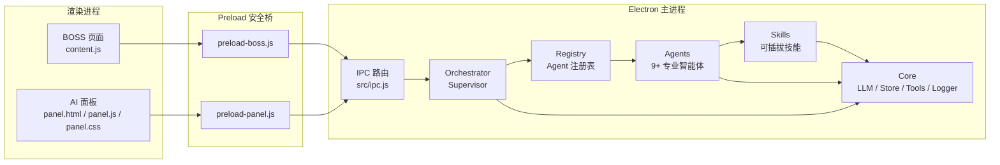
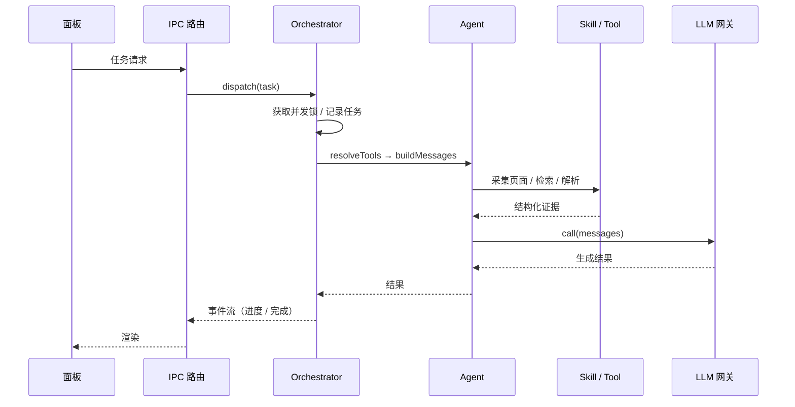

# 架构说明

## 1. 概览

BOSS直聘 AI 助手是一个 Electron 桌面应用：主进程持有全部敏感能力与业务编排，渲染进程只负责展示与用户交互。渲染进程通过 `preload` 暴露的白名单 API 与主进程通信，无法直接访问 Node.js、文件系统的任意路径或网络凭据。

---

## 2. 视图层

| 视图 | 载体 | 职责 |
|---|---|---|
| BOSS 视图 | `WebContentsView` | 内嵌 BOSS 直聘页面，注入 `content.js` 做只读 DOM 采集与悬浮组件 |
| 面板视图 | `WebContentsView` | 常驻 AI 面板，所有功能入口与结果展示 |
| 检索视图 | 隐藏 `BrowserWindow` | 后台职位库检索，不干扰当前浏览 |
| 小红书视图 | 主视图导航 | 用户自行登录后复制口碑内容作为证据 |

`main.js` 负责窗口创建、视图布局（`layoutViews`）、生命周期与崩溃恢复；视图尺寸变化时通过 `setBounds` 同步。

---

## 3. IPC 边界

`desktop/src/ipc.js` 是唯一的跨进程入口：

- **白名单**：只注册面板与网页桥需要的 channel；未知 channel 直接拒绝。
- **权限隔离**：网页桥（`preload-boss.js`）只能读取页面上下文、提交显式请求，无法读取 `settings.json`、API Key 或简历。
- **超时与并发**：所有请求带默认超时；Agent 任务通过 Orchestrator 的并发锁保证同一时刻只运行一个任务。
- **事件流**：任务进度、结果与错误通过事件推送到面板，避免轮询。

新增 IPC 能力时必须同时更新 `preload-*.js` 的白名单与对应的集成测试（`tests/integration/ipc.test.js`）。

---

## 4. 编排层

**Orchestrator**（`src/orchestrator.js`）：基于 EventEmitter 的 Supervisor，负责任务路由、并发控制、进度回调、任务记忆与取消。

**AgentBase**（`src/agents/agent-base.js`）：统一生命周期 `resolveTools → buildMessages → llm.call`。每个 Agent 独立配置角色、温度、模型与工具集：招呼语、回复、面试、岗位匹配、公司尽调、求职信、聊天、公司名解析、风险速查、职业顾问。

---

## 5. Skills 与 Core

- **Skills**（`src/skills/`）：`communication`、`jd-parsing`、`resume-analysis`、`risk-assessment`、`web-intelligence` 五个技能模块，由 `skill-loader.js` 动态加载，可热插拔。
- **多模型 LLM 网关**（`src/core/llm.js` + `src/core/model-config.js`）：同一接口适配 Ollama 原生 `/api/chat`、Gemini 原生 `generateContent` 与 OpenAI 兼容服务（DeepSeek / OpenRouter / 硅基流动 / 阿里云百炼 / LM Studio / 自定义）。统一处理超时、重试、用量统计、动态模型列表、按服务独立加密 Key 与「仅免费模式」保护；请求禁止自动跟随重定向，避免凭据外泄。
- **在线简历链路**（`content/online-resume.js` → IPC → `online-resume.js`）：从 BOSS 页面读取正文段落，分段优化后仅在用户确认时回填编辑框；保留原文备份、撤回与人工编辑保护。
- **Store**（`src/core/store.js`）：加密保存 API Key，原子写入配置与业务数据，保留 `.bak` 恢复副本。
- **Tools**（`src/core/tools.js`）：百度 / 搜狗 / Bing 公开检索与结构化字段抽取，多值投票解决证据冲突。
- **WritingStyle / LearningAdapter**：跟踪 accept / modify / reject 反馈，动态调整提示词策略，保持输出风格稳定。

---

## 6. 数据与隐私保护

| 数据 | 存放位置 | 是否外发 |
|---|---|---|
| API Key | 本机加密配置 | 仅作为 LLM 请求凭据 |
| 简历 | 本机配置 / 版本快照 | 调用模型时随任务发送必要片段 |
| JD / 聊天片段 | 内存与本地缓存 | 调用模型时随任务发送必要片段 |
| 登录态 | Electron session | 否 |
| 检索证据 | 本地缓存（最近报告） | 仅用于生成报告 |

仓库、CI 与截图脚本中一律使用虚构占位数据；截图流程见 `npm run capture:screenshots`。

---

## 7. 测试策略

| 层级 | 命令 | 说明 |
|---|---|---|
| 语法 | 提交前脚本 / CI | 全量 `node --check` |
| 单元 | `npm run test:unit` | Agent、Skill、工具函数，纯逻辑无副作用 |
| 集成 | `npm run test:integration` | IPC、Store、简历导入 |
| 端到端 | `npm run test:desktop` | 真实 Electron + 本地网页 + 模拟模型，覆盖创建、重启恢复与敏感信息隔离 |

所有测试都不调用真实付费 API，也不依赖真实平台账号。

---

## 8. 扩展指南

- **新增 Agent**：在 `src/agents/` 继承 `AgentBase`，在 `prompts/` 添加模板，最后在 `src/registry.js` 注册。
- **新增 Skill**：在 `src/skills/` 新建目录并编写 `manifest.json` 与 `index.js`，由加载器自动发现。
- **新增页面能力**：优先在 `src/skills/jd-parsing/selectors.json` 中扩展选择器，避免改动内容脚本主干。
- **新增 UI**：遵循 `panel.css` 的 Design Tokens，保持 420px 面板宽度下的可用性。
